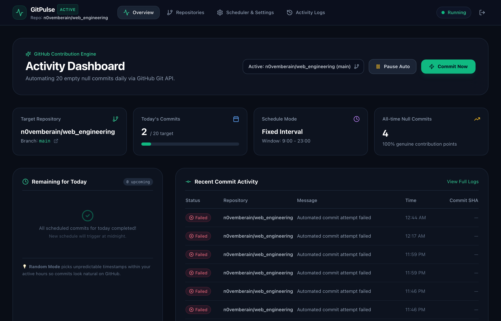
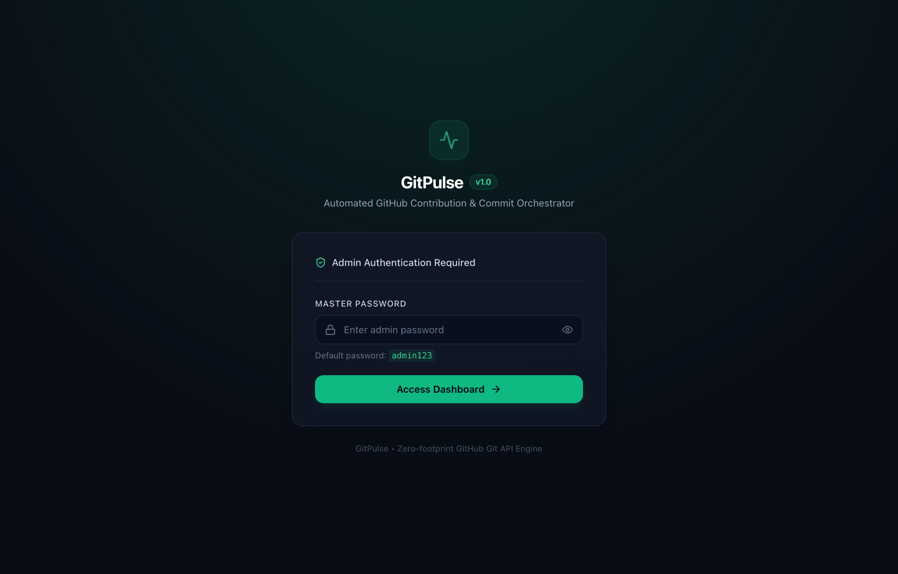
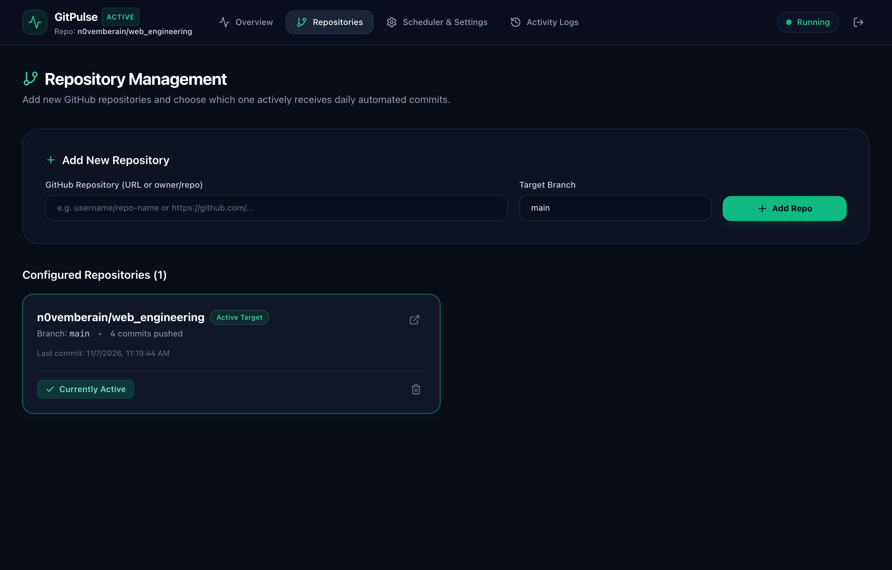
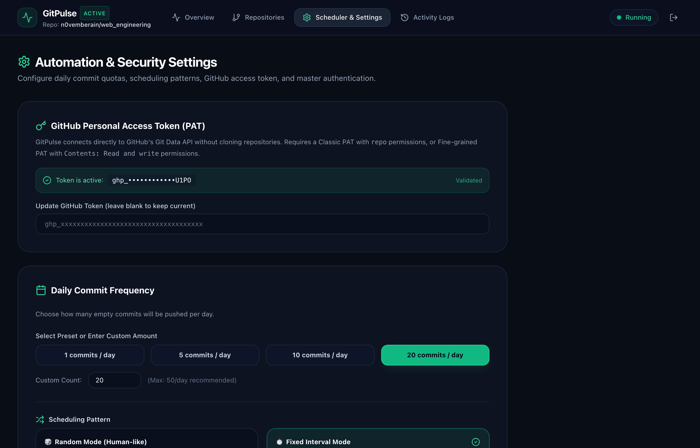
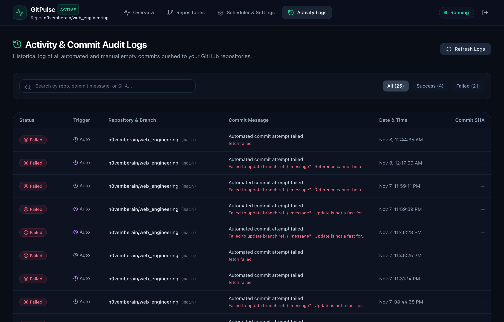

<div align="center">

# GitPulse ⚡

### Automated GitHub Activity Orchestrator & Commit Dashboard

**A full-featured, automated desktop & web application that schedules and pushes genuine empty ("null") commits to GitHub repositories with fine-grained control over frequency, repository selection, timing modes, and secure admin authentication.**

[-000000?style=for-the-badge&logo=apple&logoColor=white)](https://github.com/n0vemberain/GitPulse/releases)
[](https://nextjs.org/)
[](https://www.electronjs.org/)
[](https://tailwindcss.com/)
[](https://docs.github.com/en/rest/git)

<br/>

[📥 Download macOS .DMG](https://github.com/n0vemberain/GitPulse/releases/latest) • [✨ Features](#-key-features) • [🖼️ UI Previews](#-application-tour--screenshots) • [🚀 Quick Start](#-quick-start) • [⚙️ Configuration](#-configuration-guide)

</div>

---

## 🌟 Key Features

- 🔐 **Secure Admin Authentication:**
  Master password/PIN protected login screen to keep your dashboard and GitHub tokens safe. Default password: `admin123` (customizable anytime in settings).

- 🗂️ **Dynamic Repository Management:**
  Add multiple GitHub repositories (`owner/repo` or full GitHub URL) and switch the active target anytime with a single click.

- 🎯 **Flexible Daily Commit Frequency:**
  Choose whether to push **5, 10, 20**, or any custom number of empty commits per day.

- 🎲 **Intelligent Scheduling Patterns:**
  - **Random Mode (Human-like ⭐):** Distributes commits at unpredictable random timestamps within your active working window (e.g. 09:00 AM – 10:00 PM), appearing natural on your GitHub graph.
  - **Fixed Interval Mode:** Divides the daily window evenly and triggers commits at equal intervals (e.g. every 2.5 hours).

- ⚡ **Instant "Commit Now" Trigger:**
  A dedicated button on the dashboard to immediately push a verified empty commit to your active repository with instant feedback and direct links to GitHub.

- 🌐 **Zero-Clone Git Engine:**
  Uses GitHub's official Git Data API (`/git/refs` and `/git/commits`) directly. Creates genuine empty commits referencing root tree SHA without cloning repositories locally, saving gigabytes of disk space and avoiding git conflicts.

- 📊 **Activity & Audit Logs:**
  Searchable real-time history tracking all automated and manual commits, execution statuses, commit messages, and clickable GitHub SHA links.

---

## 🖼️ Application Tour & Screenshots

### 1. Main Activity Dashboard
The command center displaying live target repository, daily commit progress bar, upcoming scheduled commits for today, quick automation toggles, and recent commit history.



---

### 2. Secure Admin Login Portal
Protected authentication gate preventing unauthorized access to your scheduling configuration or GitHub credentials.



---

### 3. Repository Management
Add new GitHub repositories with custom branch selection (`main`, `master`, or dev branches), track total commits pushed per repository, and switch active target in one click.



---

### 4. Scheduler & Automation Settings
Configure your GitHub Personal Access Token (PAT), daily commit volume (presets: 5, 10, 20 or custom input), schedule mode (Random vs Fixed Interval), active daily hours, and master password change.



---

### 5. Activity & Commit Audit Logs
Full searchable audit log of all automated and manual commit executions with status filters, timestamps, commit messages, and direct links to GitHub.



---

## 📦 Download & macOS Installation

You can download the pre-built `.dmg` installer directly from [Releases](https://github.com/n0vemberain/GitPulse/releases/latest).

1. Download **`GitPulse-1.0.0-arm64.dmg`** from the latest release.
2. Double-click the `.dmg` file.
3. Drag **GitPulse** into your **Applications** folder.
4. Launch **GitPulse** from Launchpad or Spotlight.
5. Log in using default password: **`admin123`**.

> **Note for Apple Silicon Macs:** Built natively for Apple Silicon (`arm64` - M1, M2, M3, M4 Macs).

---

## 🚀 Quick Start (Development & Web Mode)

To run GitPulse locally as a web application:

```bash
# 1. Clone the repository
git clone https://github.com/n0vemberain/GitPulse.git
cd GitPulse

# 2. Install dependencies
npm install

# 3. Start development server
npm run dev
```

Open **[http://localhost:3000](http://localhost:3000)** in your browser.

---

## ⚙️ Configuration Guide

### 1. GitHub Personal Access Token (PAT)
1. Go to [GitHub Settings → Tokens (classic)](https://github.com/settings/tokens).
2. Click **Generate new token (classic)**.
3. Check the **`repo`** scope (Full control of private repositories).
4. Copy the generated token (`ghp_...`).
5. In GitPulse, navigate to **Scheduler & Settings**, paste the token, and click **Save**.

### 2. Adding a Target Repository
1. Go to the **Repositories** tab in GitPulse.
2. Enter your repository in `username/repo-name` format or paste the full GitHub URL.
3. Set the target branch (e.g. `main`).
4. Click **Add Repo** and ensure it is selected as the **Active Target**.

### 3. Verification
Click the **"Commit Now"** button on the dashboard to test pushing an empty commit immediately.

---

## 🛠️ Tech Stack & Architecture

- **Frontend:** Next.js 14 App Router, React 18, Tailwind CSS, Lucide Icons
- **Desktop Runtime:** Electron 45, Native macOS DMG packager
- **API Engine:** GitHub REST Git Data API (refs, commits, trees)
- **Session & Auth:** Jose (JWT) with HTTP-only cookies, PBKDF2 password hashing
- **Data Persistence:** Atomic JSON/SQLite engine writing to macOS `~/Library/Application Support/GitPulse`

---

## 📄 License

MIT License © 2026 GitPulse.
